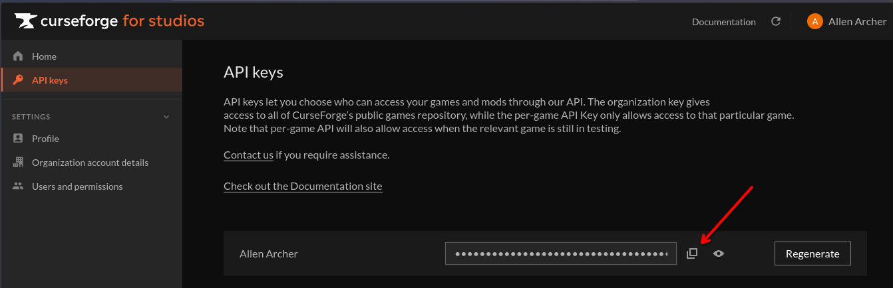
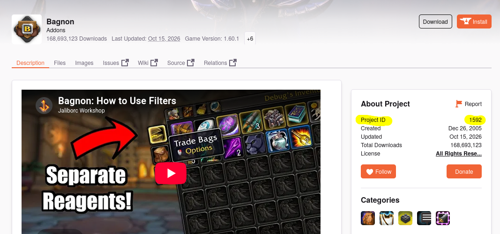

# WoW Addon Updater

Updates WoW addons from CurseForge via the CFCore API, since Linux addon managers
tend to be unreliable.

## Setup

1. Log in to your account (or create a new one) at https://curseforge.com 
2. Go to the curseforge for studios site at https://console.curseforge.com
3. Click on API keys in the sideboard.
4. Click the button to copy the API key to your clipboard.

   
5. Save it with no trailing content other than the key itself:
   ```
   echo -n "<your key>" > api-key
   ```
6. Copy `config.example` to `config` and set `ADDONS_DIR` to your WoW
   `_retail_/Interface/AddOns` path.
7. Add addons to `addon-list`, one CurseForge Project ID per line. Find the
   Project ID on the addon's curseforge.com page, right sidebar under "About
   Project". Comments (`#`) are allowed.

   

## Usage

```
./update.sh
```

For each addon in `addon-list`, this checks the latest Retail file and:
- downloads + installs it if it's new
- reports "up to date" if you already have the latest
- reports "update available" with a link to the CurseForge page if the
  author has disabled third-party API downloads (you'll need to grab that
  one manually)

It also installs and deletes any `.zip` files sitting in this directory, for
addons downloaded manually.

## Files

- `api-key` — your CFCore API key (gitignored, not committed)
- `config` — your local settings, e.g. `ADDONS_DIR` (gitignored, not committed; copy from `config.example`)
- `addon-list` — list of addons to track, by CurseForge Project ID
- `installed-versions.json` — tracks the last installed/seen file ID per addon (gitignored, local state)
- `update.sh` — the script
